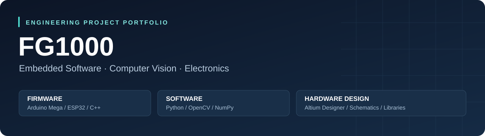

<p align="center">
  
</p>

<p align="center">
  <a href="#project-at-a-glance">Overview</a> ·
  <a href="#explore-the-project">Explore the source</a> ·
  <a href="#repository-structure">Repository map</a> ·
  <a href="docs/README.tr.md">Türkçe</a>
</p>

# FG1000

A multidisciplinary graduation project bringing together **embedded software, camera-based image processing and electronic schematic design**. This repository presents the project's Arduino Mega and ESP32 source code, Python vision applications and Altium design documents in one navigable collection.

**Project owner:** [FurkanUstaoglu](https://github.com/FurkanUstaoglu)

## Project at a glance

| Area | Technologies | Source material |
| :--- | :--- | :--- |
| Embedded software | Arduino Mega 2560, ESP32, C/C++ | Separate board-specific firmware folders |
| Computer vision | Python, OpenCV, NumPy | Balloon detection, RealSense camera processing and a camera check script |
| Electronic design | Altium Designer | Project file, schematics and component libraries |
| Documentation | Markdown | Source map, review guide and Turkish overview |

The repository highlights work across software and electronics. The components are presented as separate source areas; their presence here does not establish a verified end-to-end integration.

## Explore the project

| Start here | What to review |
| :--- | :--- |
| [Arduino Mega sources](firmware/arduino-mega/) | The original `RCWS_v1` source set and a separate Arduino experiment |
| [ESP32 sources](firmware/esp32/ESP32_Code/) | The ESP32 application and its embedded web interface |
| [Python applications](software/balloon-vision/src/) | Image processing and camera-related source files |
| [Altium project](hardware/altium/FG1000/) | Electronic schematics and project-specific libraries |
| [Reviewer guide](docs/project-guide.md) | A short guide to the files and the scope of the evidence |

## Repository structure

```text
fg1000-project/
├── firmware/
│   ├── arduino-mega/
│   │   ├── RCWS_v1/           # Original source set
│   │   └── Arduino_Code/      # Separate experiment
│   └── esp32/
│       └── ESP32_Code/
├── software/
│   └── balloon-vision/
│       ├── src/               # Python applications
│       └── samples/           # Archived captures and settings
├── hardware/
│   └── altium/
│       ├── FG1000/            # Project, schematics, local libraries
│       └── vendor-libraries/  # Third-party component libraries
└── docs/
    ├── assets/                # Portfolio artwork
    ├── README.tr.md           # Turkish overview
    └── project-guide.md       # Reviewer guide
```

Folder names separate firmware, desktop software and electronic design. Original Arduino sketch names and Altium document references are preserved to retain their file relationships.

## Scope and status

This is a **source portfolio**, not a validated release. No compilation, hardware operation or end-to-end test was performed during repository preparation. The two Arduino source sets are retained separately; neither is designated as a production release.

The Altium material includes schematics and component footprint libraries. A completed `.PcbDoc` board layout is not included. Archived camera captures are development material, not performance benchmarks or a demonstration of successful detection.

## Publication notes

- Virtual environments, caches and Altium history backups are excluded.
- Local provenance records containing computer-specific paths are excluded.
- No measured accuracy, range, reliability or deployment claim is made.
- Third-party libraries remain identifiable under `vendor-libraries/`.

## Rights and attribution

No repository-wide license has been granted. Third-party component libraries remain subject to their respective owners' terms. Their inclusion does not imply authorship by the project owner.

---

[Turkish overview](docs/README.tr.md) · [Reviewer guide](docs/project-guide.md) · [File organization notes](docs/organization.md)
